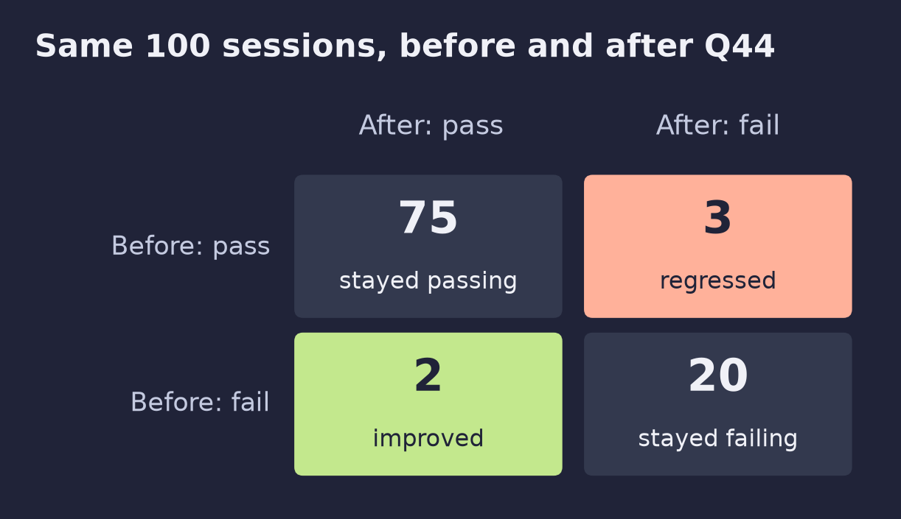

I let Codex work on a new model for my threat.gg honeypots for most of a month. By the time I added it up, I'd spent over $200 on Runpod. When I wanted my 4080 back to play games, the model I moved to a rented GPU was r6. The newer one, r11, had spent a lot more time on rented GPUs. I couldn't show that it gave better answers.

A honeypot gives someone who connects to it a machine to poke around in. For threat.gg I wanted one small model that could play the part of a shell over SSH or Telnet, or a database over PostgreSQL or SQL Server. If the shell says the machine has 8 GB of RAM, the next command should agree. A database client wants actual columns and rows. If it asks for one row and gets two, it hardly matters how plausible the second one looks.

## How I got to r6

I started with SSH and used replies from a larger model as training examples for a smaller one. That's most of what I mean by *distillation* here. The first run used 17,849 examples and took about an hour to train on an H100. I used LoRA, which let me train a small set of extra weights and merge them into the model afterward. I also had to check what I was teaching it. The larger model sometimes contradicted the machine's own specs or reported an impossible uptime.

Early on I tried three small models on the cleaned-up SSH data. Qwen3-0.6B won that comparison, and its quantized model file came in at about 391 MB. I could run that on hardware I already had.

Some of the most productive training runs were pretty boring. The model had trouble with the statements SQL Server clients send when they first connect, and with PostgreSQL queries that specify a row limit. I added examples of both. On the same checks, r6 answered 29 of 30 SQL Server openers correctly, up from 27. On the PostgreSQL limit cases it went from 27 of 32 to 31. Training took about 96 minutes on an L40S.

Keeping those gains got harder. I ran the r10 model through 100 test sessions and it passed 88. The older r9 weights paired with the r10 client passed 92. The client had learned how to recover complete rows from a partial SQL reply. That was a useful change to the Go code, but I still wanted a single model I could export, put on another box, and get the same answers from.

## What was actually in a training batch?

One r11 run stopped after 3,200 minibatches. The files on disk included plenty of long answers. When I counted the batches the trainer had actually read, it had gone through about 9% of the intended material and had barely seen the longest answers. Those were exactly the ones I wanted it to finish.

There was also an off-by-one error on the Mac training path. Training batches use padding so sequences of different lengths fit together. A mask tells the trainer which tokens count toward the loss. The checker I'd been looking at used unpadded examples. When I looked at an actual padded batch, the mask included one extra token on every row. Token zero decodes to an exclamation mark.

The test I like for this one is to change the contents of the padding and run the same batch twice. After fixing the end index, I got identical loss and gradients. I'd keep that test even if I threw the model away. It catches the extra token regardless of what the model eventually learns to print.

With the mask fixed, I ran the 0.6B model twice with different random seeds. Each run went through 34,626 minibatches, grouped into 199 weight updates. The exported models passed 94 and 95 of 100 sessions on the benchmark I was using then. Both fell short on SSH, and neither met the tighter limit on malformed replies. I kept both checkpoints.

## Was I being too picky?

I also tried a larger Qwen with 1.7 billion parameters. For one of those runs (Q44 in my notes), I could compare the starting checkpoint and the trained model session by session. A session is a whole conversation with the honeypot. One bad answer can spoil a run of otherwise sensible replies.

The starting checkpoint passed 78. After training it passed 77. PostgreSQL accounted for 14 of the 23 failures. In a separate SQL check, the model got the column type right for a timestamp and put a value in the cell that our Go parser couldn't read. I changed just the timestamp text in copies of the saved replies. All eight parser rejections cleared. That's a tempting reason to rent another GPU and train on dates.

Before doing that I went back to the 100 sessions. Nine of the failures had *only* a reply-format flag. Even giving the model all nine for free gets it to 86, and the release target is 92. Another session had both a format error and wrong rows, so it would still fail. I put the GPU rental on hold.

## Getting my gaming PC back

I still needed somewhere to run r6. I got a US A4000 on Runpod for $0.174 an hour including disk, about $129 for a 31-day month at that rate. On the first burst test, with up to 12 requests in flight, the model answered only 8 of 36 ordinary requests before their three-second deadline.

The biggest improvement came from turning *off* llama.cpp's extra RAM prompt cache. I kept HTTPS connections pooled for both runs, kept the same weights and 12 slots, and changed the cache from 2 GiB to zero. That got 28 of 36 replies back in time. I also tried FP16 for the attention key/value cache. With that setup, one request at a time, 10 of 12 first SQL queries made their much shorter 500 ms deadline. Sending those queries in bursts still got me zero of 18.

I moved production over for a short trial on November 25. In the first five minutes or so the student answered 128 of 134 attempts, with a median of 614 ms for the replies it served. Most were SSH. There wasn't a single PostgreSQL reply in that sample, so I still want to see what happens during a busy stretch of database traffic.

Training is paused. The next thing I want to know is whether either of those old 199-update checkpoints beats r6 on sessions it hasn't seen. First I need to check which test examples or templates made it into their training data. If there's a clean comparison left, I already have the three model files I need to run it.
