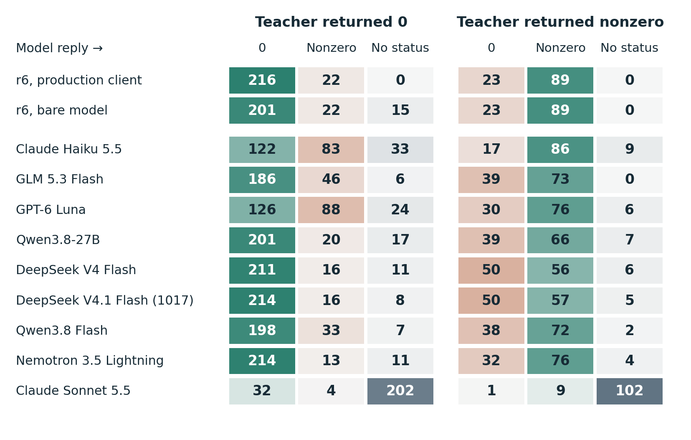
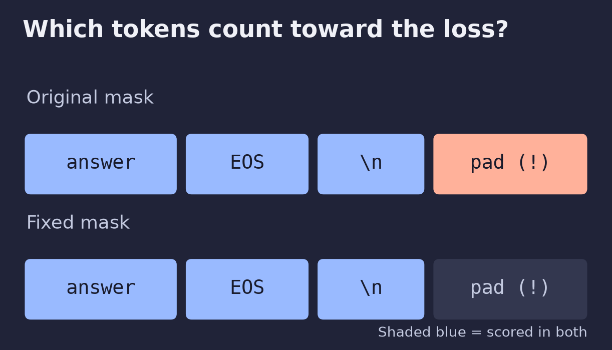

I've been working on a small model for threat.gg, a project that lets you run honeypots on your own servers. The SSH logs already tell me which IP connected and what username and password they tried. I wanted to see what they'd do once they got a shell. That gets tricky when they type a command I haven't written a response for.

For example, over two months this summer I got 54,613 GPU checks across 24,038 SSH sessions. You could follow a client from checking the kernel and CPU to looking for a graphics card. Even when the IP changed I could group some of those sessions by their SSH client banner. Whether they wanted to mine on the box or run inference is harder to tell. [Summer SSH campaign report](https://threat.gg/blog/ssh-threat-actors-may-july-2026)

## What the honeypots record {#what-i-get-out-of-answering}

The SSH honeypots were already collecting those sessions before I trained anything. By October I had nearly 40,000 distinct command patterns. I can answer `nproc` in a few lines of Go. I wanted to keep doing that for common commands and have something small I could call for the ones I hadn't implemented. It had to use the same machine specs as the Go code. On the database side some clients only give you half a second to answer their first query.

If you open an SSH session you can see the command, the working directory, what we sent back and the exit code. For PostgreSQL I can look up a query and see the generated rows, the earlier turns and the database profile the model used. I checked a two-hour window in production and could match all 10,918 generation records to their queries. That distinction matters when I'm looking at the GPU scans. The visitor asked about a card. We're the ones who told them the box had an NVIDIA card.


I thought the hardware we advertised might explain why some bots stayed long enough to download something. In October I compared 623 sessions that issued a download command with about 48,700 that stopped. Both groups had seen much the same mix of replies to the CPU and graphics checks. I couldn't tell from that comparison why one group stuck around.

Once I have a file I can search by SHA-256. A backfill turned up over 120,000 links between shell commands and downloaded files, but only 2,201 distinct samples. Pick a sample and you can see which sessions downloaded it, even if each used a different filename.

## Why train a model this small?

I wanted to run one model myself for SSH, Telnet, PostgreSQL and SQL Server. Calling a hosted model for every unfamiliar command means sending it the session history and waiting on another round trip. For a first SQL query I often can't make the call at all (our service needs at least 1.5 seconds left before it'll try the larger model).

I started with SSH. I already had commands and replies from the larger model, so I used those to train the smaller one. That's the distillation part. The first run had 17,849 examples and took about an hour on an H100. I used LoRA so I could train a small set of additional weights and merge them back into the model. Going through the replies first helped. Some of our training examples had the wrong machine specs or an uptime the machine couldn't possibly have.

Of the three small models I tried on the cleaned-up SSH data, Qwen3-0.6B did the best. The quantized file was about 391 MB. I used Qwen again for the sixth revision (r6), which is the one I ended up deploying.

## From a session transcript to train.jsonl

Each run has a directory with a `run.env` for the protocols, base model and synthetic query inputs. The pipeline records completed steps and file checksums there too. I ran the first three steps from the project checkout.

```sh
run="$HOME/dev/distill-artifacts/runs/r6"
scripts/distill/pipeline.sh export "$run"
scripts/distill/pipeline.sh synth "$run"
scripts/distill/pipeline.sh prep "$run"
```

The export keeps the machine profile and previous turns in the prompt and the teacher's reply in the completion. I had 238,591 SSH rows to choose from. I removed duplicates and kept at most 24 examples per command pattern. There's only so much I want the model to learn from one scanner running the same command all afternoon.

SQL had a hole in the data. When a client times out on its first statement I have the query it sent but no reply to train on. I gave `synth` a file of common first statements for each database and had the teacher answer them offline using the decoy profiles. After filtering I got another 104 SQL Server examples and 377 PostgreSQL examples that way.

The Go evaluator runs on each source separately during `prep`. On SSH it strips shell prompts the teacher left at the end of replies and drops SCP protocol exchanges. Of 19,355 SSH training rows, 17,064 made it through cleanup and 16,436 through the quality filter. With all four protocols combined I had 21,669 rows in `data/train.jsonl` and 2,372 in `data/holdout.jsonl`.

## The command that trained r6

I copied the prepared data to a Runpod L40S. On the pod, the `train` stage ran this with the model name filled in.

```sh
cd /workspace
python cuda/train.py --data data --out out/qwen3-0.6b --model Qwen/Qwen3-0.6B
```

### Following one row through `train.py`

Here's one SSH example. The `prompt` has the machine profile, three earlier exchanges and a final `nproc`. The entire `completion` is this assistant reply.

```json
{"stdout":"6\n","exit_code":0,"cwd":"/root"}
```

In `scripts/distill/cuda/train.py`, `main()` loads `train.jsonl` and calls `tok.apply_chat_template` on `prompt + completion`. Count the tokens *after* applying the template so you include the role markers. I dropped all 149 examples over 4,096 tokens out of the 21,669 I started with. If you truncate at the limit you can cut the closing brace off the reply you're teaching the model to send.

I use `is_valid()` to keep a command template on the same side of the training/validation split.

```python
h = hashlib.sha256(("mlx-valid\x00" + template).encode()).digest()
return int.from_bytes(h[:2], "big") % 100 < pct
```

With `pct=2`, buckets 0 and 1 go to validation. `nproc` hashes to bucket 70. A four-CPU box and a six-CPU box can have different answers and both examples still go into training. After the split I only need the `prompt` and `completion` columns. That left 21,051 rows for training and 469 for validation (the 2,372 holdout prompts are in a separate file that `train.py` never reads).

Hugging Face's TRL library runs the batches. I pass in both datasets, the tokenizer (`tok`), the optimizer and batch settings (`cfg`) and the adapter config (`lora`).

```python
trainer = SFTTrainer(
    model=model, args=cfg, train_dataset=train,
    eval_dataset=valid if len(valid) else None,
    processing_class=tok, peft_config=lora,
)
trainer.train()
```

With `completion_only_loss=True` the model sees the whole conversation up to and including `nproc`. Only the tokens in the assistant's reply count toward the loss. In this example it has to predict the 6, the working directory and the JSON around them.

I loaded the Qwen weights in BF16 and left them frozen. `LoraConfig` adds rank-32 adapters to the linear layers (alpha 64, 5% dropout). I grouped examples by length to save on padding and used four examples per batch. After four batches the optimizer updates the adapter weights. I warmed up the learning rate to `2e-4`, used cosine decay and ran validation every 200 optimizer steps. Two epochs on the L40S took 5,732 seconds (about 96 minutes).

## Testing the file I was going to serve

At the end of `train.py` I save a copy of the adapter, then merge the weights and save the tokenizer alongside them.

```python
trainer.save_model(os.path.join(a.out, "adapter"))

merged = trainer.model.merge_and_unload()
merged.save_pretrained(os.path.join(a.out, "merged"))
tok.save_pretrained(os.path.join(a.out, "merged"))
```

The rest of the job runs from `/workspace`. It uses `merged` for both the reference replies and the 4-bit build.

```sh
python cuda/generate.py --model out/qwen3-0.6b/merged \
  --prompts prompts.jsonl --out replies-qwen3-0.6b.jsonl

python /root/llama.cpp/convert_hf_to_gguf.py out/qwen3-0.6b/merged \
  --outtype f16 --outfile gguf/qwen3-0.6b-f16.gguf
/root/llama.cpp/build/bin/llama-quantize \
  gguf/qwen3-0.6b-f16.gguf gguf/qwen3-0.6b-q4_k_m.gguf Q4_K_M
python remote/grammar_check.py qwen3-0.6b
```

I generated a BF16 reply for every holdout prompt with greedy decoding and thinking disabled. For the last check I ran the first 40 prompts through llama.cpp with the 4-bit file and the same grammar I use for serving. I got this in the log.

```text
qwen3-0.6b: Q4_K_M with grammar valid 39/40, identical to bf16 27/40
```

The one invalid reply kept printing blank lines. For the SQL tests I went through the production student client and checked the rows I got back. On SQL Server, r6 got 29 of 30 opener cases right (r5 got 27). For PostgreSQL queries with a row limit it got 31 of 32 (also 27 on r5).

About 15 hours into the rollout I had 205 rejected PostgreSQL replies. 201 of them were for the same role-count query. If I ran it early in a replay I'd get one value back. If I ran it after a wider table result I'd sometimes get two values in a one-column row. Having the previous query in the transcript gave me a way to reproduce it. It also gave me a multi-turn SQL case for the next training set.

## How did it do against the hosted models?

I built HoneyBench so I could run the same traffic against my model, the teacher and a few hosted models. Checking the text against the teacher's reply only gets you so far. Two shells can word an error differently. I care whether the hostname agrees with the decoy profile and whether a table the client just created is still there when it queries it.

HoneyBench v2 has 536 individual turns and 100 whole sessions. In v1 I picked turns the teacher had answered cleanly, which left out some of the cases I cared about (like a database client timing out). In v2 those live requests can get picked too. For a single turn I give each model the recorded history. For a session it has to live with whatever it said on the previous turn.

### How HoneyBench scores a reply

`honeybench run` saves the replies so I can run `honeybench score` offline. In scorer v3, `Score` in `internal/ai/bench/score.go` checks the benchmark hash, item IDs and turn numbers. Pass the training file with `-train` and it skips turns with a template the model trained on (nine headline turns for r6). A timeout or missing reply on any of the remaining turns counts as a failure.

For a reply, `Score` passes the messages, profile and output to `eval.ScoreChat`. It gets the command or query from the last user message. Take the six-CPU machine again. If the reply to `nproc` parses fine but stdout says 8, `verifyCPUCount` in `internal/ai/eval/facts.go` fails the `facts.cpus` check. Unrelated checks are marked inapplicable. HoneyBench saves the name of each hard check that failed.

```go
for _, c := range r.HardFailures() {
    out.Failed = append(out.Failed, c.Name)
}
out.Pass = len(out.Failed) == 0
```

For SQL, `ScoreChat` parses the result set and checks the columns and how many rows the query could return. The scorer also records text similarity when it has a teacher reply. That's a separate column, so different wording won't fail a turn by itself.

For sessions I skip inputs the service handles locally and rebuild the history with the model's own replies. `eval.ScoreSession` then checks them against each other. One PostgreSQL client sent r6 the same `SELECT` four times in a row and got 48 rows, then 16, 16 and 16. All four passed on their own. The session failed one check, `consistency.repeat`.

### Where the 93.2% comes from

With the production client, r6 passed 335/346 SSH turns, 79/79 Telnet, 79/80 PostgreSQL and 17/22 SQL Server. If you count them all together that's 510/527 (96.8%). I didn't want 346 SSH commands to drown out 22 SQL Server queries, so `TrackScore.fill` averages the four pass rates. That gives r6 93.2%. For sessions I just counted how many of the 100 passed all the way through.

| Model | Turn score | Sessions passed / 100 |
| --- | ---: | ---: |
| r6, production client | 93.2% | 88 |
| r6, bare model | 92.9% | 81 |
| Claude Haiku 5.5 | 82.5% | 75 |
| GLM 5.3 Flash | 80.6% | 64 |
| GPT-6 Luna | 80.0% | 75 |
| Qwen3.8-27B | 79.8% | 64 |
| DeepSeek V4 Flash | 78.7% | 75 |
| DeepSeek V4.1 Flash (1017) | 78.3% | 66 |
| Qwen3.8 Flash | 77.5% | 69 |
| Nemotron 3.5 Lightning | 73.0% | 59 |
| Claude Sonnet 5.5 | 12.1% | 2 |

To compare revisions I use `paired()` in `report.go` to match turns by ID. r6 fixed nine turns that r5 failed and broke three that used to pass. The exact McNemar test uses those twelve disagreements. I got `p = 0.146` (the report needs p below 0.05 to call one better).

Both r6 runs used the same weights and llama.cpp grammar. Just using the production client got me seven more complete sessions, since it can stop loops and recover a usable reply from partial output. I sent the hosted models the JSON schema through OpenRouter. Sonnet came back empty with no token usage on 1,196 of 1,550 replies across the run. HoneyBench counts those as provider refusals, which explains a lot of that row.

To rerun the r6 score, run this from the benchmark directory with the v3 scorer. You'll see 80.2% for sessions in the CLI. That's the average across the four protocols. If you count individual sessions in the results file you get 88 passes.

```sh
honeybench score -bench honeybench-v2 \
  -predictions results-v2/r6.served.predictions.jsonl \
  -train ../runs/r6/data/train.jsonl -out /tmp/r6-score.json
```

### Did the shell command succeed?

For the confusion matrix I used the 350 SSH and Telnet turns with a recorded teacher exit code. The teacher returned zero on 238 and nonzero on 112. This lets me compare which commands each model said succeeded. To settle a disagreement I'd still need to run the command on a real shell. The 93.2% turn score above uses the hard checks.

[](honeybench-shell-exit-matrix.png)

DeepSeek V4 Flash and Haiku both passed 75 sessions. On the 112 commands where the teacher returned failure, DeepSeek returned success 50 times and Haiku did it 17 times. Go the other way and Haiku returned failure on 83 commands the teacher said succeeded. DeepSeek did that 16 times. I kept replies without a readable integer exit code in the counts under “No status”.

You can download the counts, turn-score intervals and session totals for the earlier models and client changes too. [CSV for all 24 saved runs](honeybench-v2-results.csv)

The client mattered on later revisions too. r10 passed 88 of the 100 sessions. If I kept the r10 client and put the older r9 weights behind it I got 92. Recovering complete rows from a partial SQL reply helped in Go. I still wanted to be able to copy the model to another machine and get the same answers.

## Debugging the r11 training batches {#what-was-in-a-training-batch}

I spent most of a month on r11 with Codex. One run stopped after 3,200 minibatches. I had plenty of long replies in the training file, but when I counted the batches the trainer had read it had only gone through about 9% of the material. It had barely touched the long answers I was trying to get it to finish.

On the Mac I also found an off-by-one in the loss mask. The trainer pads rows to fit them in a batch. My checker used unpadded examples, so it missed the extra token getting scored at the end of every row. Padding was token zero, which decodes to an exclamation mark.



To test the fix I changed the contents of the padding and ran the same batch twice. Once I fixed the end index I got identical loss and gradients both times. That gives me a regression test I can run without waiting to see what the model prints.

For the 0.6B retry I used MLX on the Mac. Both runs started from the same merged r9 model. Each seed got its own training data and a fresh adapter directory. This is the command for seed 11 (I've shortened the local paths, including the one to Python).

```sh
artifacts="$HOME/dev/distill-artifacts"
run="$artifacts/runs/r11-stopping"
python scripts/distill/lora.py -c "$run/repair-configs/seed-11.json" \
  --model "$artifacts/r9/out/qwen3-0.6b/merged" \
  --data "$artifacts/runs/r11-retention/repair-mlx/seed-11" \
  --adapter-path "$run/repair-out/seed-11"
```

For seed 29 I changed the config, data and output paths. Both configs use a batch size of one and accumulate gradients over 174 examples per update. At 34,626 iterations that's 199 weight updates, which is the number I used to label the checkpoint. On the benchmark I was using then, the exported models passed 94 and 95 of 100 sessions. Both still missed the SSH target and produced too many malformed replies for the tighter check. I kept the checkpoints.

## Was another training run worth it? {#was-i-being-too-picky}

I also tried Qwen at 1.7 billion parameters. For one run (Q44 in my notes) I had results for the exact same 100 sessions before and after training, so I could look up which ones changed.


The starting checkpoint passed 78 sessions. The trained model passed 77, with PostgreSQL accounting for 14 of the 23 failures. I found a timestamp in a separate SQL check where the column type was right but our Go parser couldn't read the value. I edited just the timestamp text in the saved replies and all eight parser rejections went away.

Before paying for another GPU I counted how far fixing the format could get me. Nine sessions failed on reply format alone. Even if I fixed every one I'd go from 77 to 86 passes. I needed 92. One more session had a format error *and* the wrong rows, so fixing the format wouldn't help it pass. I'd spent over $200 on Runpod at that point and left training paused.

## What the A4000 could serve

I tried the r6 Q4_K_M file on a Runpod A4000. At $0.174 an hour including disk I could leave it up for a 31-day month for about $129. With up to 12 requests in flight, only 8 of 36 ordinary requests finished within their three-second deadline.

Turning off llama.cpp's extra RAM prompt cache helped the most. I kept the pooled HTTPS connections, the same weights and the same 12 slots. With the cache set to zero instead of 2 GiB, 28 of 36 requests finished in time. I also tried FP16 for the attention key/value cache. Sending one SQL opener at a time I got 10 of 12 back inside 500 ms. In bursts I got zero of 18.

I pointed production at the A4000 for a short trial on November 25. In the first five minutes or so it served 128 of 134 attempts. Median time for a reply it served was 614 ms, mostly SSH. I didn't get a single PostgreSQL reply in that sample. I still want to see what happens when there's some database traffic.

For the next comparison I already have the files I need, r6 and the two 199-update checkpoints. First I need to check which test examples or templates got into their training data. If there's enough left to run all three on sessions they haven't seen, I can compare them without another training run.
