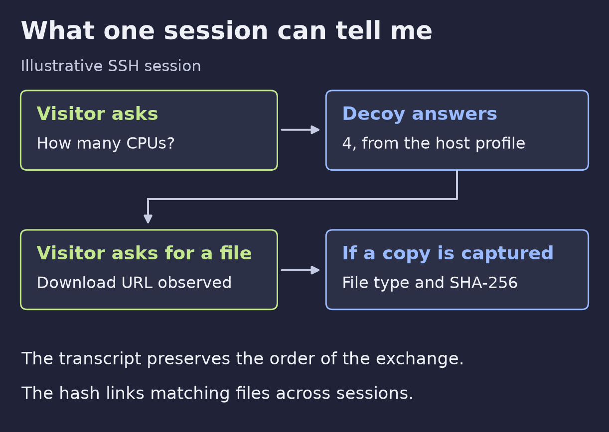

I build threat.gg, a network of honeypots you can run on your own servers. An SSH sensor lets a visitor log in to a decoy shell and records what they type. If all I kept were the source IP, the username and the guessed password, I'd miss my favorite part of the summer's traffic. A surprising number of those visitors wanted to know what graphics card the machine had.

Over two months the sensors recorded 54,613 GPU checks across 24,038 SSH sessions. I could open a session and see a client ask about the kernel and CPU, then look for a graphics device. The SSH client banner gave me another way to group those visits when the source address changed. I could tell someone was inventorying GPUs. From those commands alone I'd have a hard time saying whether they wanted a miner or a box to run inference on. [The summer SSH campaign report](https://threat.gg/blog/ssh-threat-actors-may-july-2026) has the breakdown.

## What I get out of answering

Those summer sessions predate the small model. The reason to build one was sitting in the command archive. By October it held nearly 40,000 distinct SSH command patterns. A few lines of Go will give me a good answer to `nproc`, but someone has to write and maintain each of those canned answers. I wanted the common commands to keep using those cheap, predictable answers and a small model to handle the rest. It had to remember which machine it was pretending to be. It also had to be fast enough to answer a database client that gives its first query half a second.

When I open a recorded shell session, I can see what the visitor typed, the working directory, our reply and its exit code. SQL has its own version of this. In one two-hour production check I could match all 10,918 PostgreSQL generation records back to stored queries. That lets me read a query alongside the result our service generated for it. The record also points back to the earlier turns and the machine profile used for the answer. If the decoy claims it has an NVIDIA card, that's a detail about *my decoy*. What I learned about the visitor is that they asked about the card. Their next command is a separate observation.



I had a hunch about the GPU scans. Were bots leaving because they didn't like the hardware we showed them? In an October comparison, 623 sessions went on to issue a download command and about 48,700 stopped. Both groups got much the same mix of answers to the CPU-count and graphics-device checks. I couldn't credit a particular reply for getting us to the download.

When we *do* capture a file, its SHA-256 lets me find other commands that delivered the same bytes under different names. One backfill of the older SSH data connected over 120,000 command-to-file links to just 2,201 distinct samples. That lets me start from a file and work backwards to the sessions where it turned up.

## Why train a model this small?

I wanted one model I could host myself for SSH, Telnet, PostgreSQL and SQL Server. Sending a shell command and its recent history to a hosted model adds a round trip and means handing that provider the transcript. The first-query SQL timeout is especially unforgiving. Our larger model needs a budget of at least 1.5 seconds before the service will even try it.

I started with SSH and used replies from a larger model as training examples for a smaller one. That's most of what I mean by *distillation* here. The first run used 17,849 examples and took about an hour to train on an H100. I used LoRA, which let me train a small set of extra weights and merge them into the model afterward. I also had to check what I was teaching it. The larger model sometimes contradicted the machine's own specs or reported an impossible uptime.

Early on I tried three small models on the cleaned-up SSH data. Qwen3-0.6B won that comparison, and its quantized model file came in at about 391 MB. Here's what it took to go from recorded sessions to the r6 version of that file.

## From a session transcript to train.jsonl

I kept a directory for each run. Its `run.env` named the protocols, the base model and the inputs for synthetic queries. The driver wrote a ledger of completed steps and file checksums into the same directory. For r6 I ran these three stages from the project checkout.

```sh
run="$HOME/dev/distill-artifacts/runs/r6"
scripts/distill/pipeline.sh export "$run"
scripts/distill/pipeline.sh synth "$run"
scripts/distill/pipeline.sh prep "$run"
```

The exporter rebuilt each teacher example with its original context. The prompt had the machine profile and earlier turns, and the completion held the reply I wanted the student to learn. SSH alone had 238,591 candidate rows. I deduplicated them and capped each command pattern at 24 examples. Otherwise one busy scanner could fill a good chunk of a training epoch by asking the same question all afternoon.

The SQL openers needed a different source of labels. If the client times out before the teacher answers, I get the query in my logs and no example of how to answer it. The `synth` stage took a file of common first statements for each database protocol and asked the teacher to answer them offline against the decoys' database profiles. That supplied 104 SQL Server opener examples and 377 PostgreSQL ones after filtering.

In `prep`, the Go evaluator cleaned each source separately. For SSH it stripped stray shell prompts from the ends of teacher replies and dropped SCP protocol exchanges. That left 17,064 of the 19,355 SSH training rows. The quality filter kept 16,436. After merging SSH, Telnet and the database sources, the run had 21,669 rows in `data/train.jsonl` and 2,372 in `data/holdout.jsonl`.

## The command that trained r6

I used the pipeline to copy the prepared data to a Runpod L40S. Its `train` stage launched this command inside the pod. I've filled in the model name the shell script passed to Python.

```sh
cd /workspace
python cuda/train.py --data data --out out/qwen3-0.6b --model Qwen/Qwen3-0.6B
```

Most of the recipe lived in the defaults. The CUDA trainer loaded the base weights in BF16 and fitted rank-32 LoRA adapters on the linear layers, with alpha 64 and 5% dropout. The base weights stayed frozen. The prompt was visible to the model, but only tokens in the teacher's completion counted toward the loss. I used four examples per batch and accumulated gradients over four batches per optimizer step. The learning rate started with a warmup and followed a cosine schedule with a peak of `2e-4`.

The row count changed again at tokenization. The trainer applied Qwen's chat template before checking the 4,096-token limit. It dropped 149 overlong examples whole because cutting off the end would teach the model a partial reply. It hashed the command template to assign validation rows, so variants of the same template stayed together. The saved arguments report 21,051 rows for fitting and 469 for validation. The 2,372 holdout prompts stayed separate. Two epochs took 5,732 seconds on that L40S.

## Testing the file I was going to serve

The trainer saved the adapter, merged it into the base weights, and wrote the merged model and tokenizer to `out/qwen3-0.6b/merged`. The same job generated replies from the merged model, then converted and tested the file I'd serve. These commands also ran from `/workspace`.

```sh
python cuda/generate.py --model out/qwen3-0.6b/merged \
  --prompts prompts.jsonl --out replies-qwen3-0.6b.jsonl

python /root/llama.cpp/convert_hf_to_gguf.py out/qwen3-0.6b/merged \
  --outtype f16 --outfile gguf/qwen3-0.6b-f16.gguf
/root/llama.cpp/build/bin/llama-quantize \
  gguf/qwen3-0.6b-f16.gguf gguf/qwen3-0.6b-q4_k_m.gguf Q4_K_M
python remote/grammar_check.py qwen3-0.6b
```

The first command gave me a BF16 reference reply for every holdout prompt, using greedy decoding with thinking disabled. The last command ran the first 40 prompts through the 4-bit file with llama.cpp and the serving grammar. Here's the last line from the grammar check.

```text
qwen3-0.6b: Q4_K_M with grammar valid 39/40, identical to bf16 27/40
```

The one invalid reply ran on with blank lines. Even when the JSON parsed, I still had to check whether the database client got the right rows back. Through the production student client, r6 answered 29 of 30 SQL Server opener cases correctly, up from 27 on r5. For PostgreSQL queries with a row limit it got 31 of 32, up from 27.

The PostgreSQL transcripts also gave me a bug report I never would have written myself. In roughly 15 hours after the r6 rollout, the validator rejected 205 PostgreSQL replies. Of those, 201 were answers to the same role-count query. Run early in a replayed session, the query got a single value. After a wider table result, the model sometimes put two values in a one-column row. The scanner had asked a perfectly ordinary counting question. It was our answer that was broken. Keeping the earlier result alongside the query gave me a way to reproduce it and a reason to put multi-turn SQL examples in the next training set.

I ran the r10 model through 100 test sessions and it passed 88. The older r9 weights paired with the r10 client passed 92. The client had learned how to recover complete rows from a partial SQL reply. That was a useful change to the Go code, but I still wanted a single model I could export, put on another box, and get the same answers from.

## What was in a training batch?

I spent most of a month working on r11 with Codex. One of our training runs stopped after 3,200 minibatches. The files on disk included plenty of long answers. When I counted the batches the trainer had actually read, it had gone through about 9% of the intended material and had barely seen the longest answers. Those were exactly the ones I wanted it to finish.

There was also an off-by-one error on the Mac training path. Training batches use padding so sequences of different lengths fit together. A mask tells the trainer which tokens count toward the loss. The checker I'd been looking at used unpadded examples. When I looked at an actual padded batch, the mask included one extra token on every row. Token zero decodes to an exclamation mark.


The test I like for this one is to change the contents of the padding and run the same batch twice. After fixing the end index, I got identical loss and gradients. I'd keep that test even if I threw the model away. It catches the extra token regardless of what the model eventually learns to print.

For the 0.6B r11 retry I used the MLX trainer on the Mac. I started each run from the same merged r9 model and gave each seed its own curriculum and fresh adapter directory. Here's the command from the seed-11 run plan. I've shortened the local paths and the path to Python.

```sh
artifacts="$HOME/dev/distill-artifacts"
run="$artifacts/runs/r11-stopping"
python scripts/distill/lora.py -c "$run/repair-configs/seed-11.json" \
  --model "$artifacts/r9/out/qwen3-0.6b/merged" \
  --data "$artifacts/runs/r11-retention/repair-mlx/seed-11" \
  --adapter-path "$run/repair-out/seed-11"
```

Seed 29 used its own config, data and output paths. Both runs used a batch size of one. MLX accumulated gradients for 174 examples before it updated the adapter weights. So the 34,626 iterations in the config amounted to 199 updates. That's the number I used to label the checkpoints. The exported models passed 94 and 95 of 100 sessions on the benchmark I was using then. Both fell short on SSH, and neither met the tighter limit on malformed replies. I kept both checkpoints.

## Was I being too picky?

I also tried a larger Qwen with 1.7 billion parameters. For one of those runs (Q44 in my notes), I could compare the starting checkpoint and the trained model session by session. A session is a whole conversation with the honeypot. One bad answer can spoil a run of otherwise sensible replies.


The starting checkpoint passed 78. After training it passed 77. PostgreSQL accounted for 14 of the 23 failures. In a separate SQL check, the model got the column type right for a timestamp and put a value in the cell that our Go parser couldn't read. I changed just the timestamp text in copies of the saved replies. All eight parser rejections cleared. That's a tempting reason to rent another GPU and train on dates.

Before doing that I went back to the 100 sessions. Nine of the failures had *only* a reply-format flag. Even giving the model all nine for free gets it to 86, and the release target is 92. Another session had both a format error and wrong rows, so it would still fail. I'd spent over $200 on Runpod by then. I held off on another training run.

## What the A4000 could serve

I tested the r6 Q4_K_M file on a Runpod A4000 at $0.174 an hour including disk, about $129 for a 31-day month at that rate. On the first burst test, with up to 12 requests in flight, the model answered only 8 of 36 ordinary requests before their three-second deadline.

The biggest improvement came from turning *off* llama.cpp's extra RAM prompt cache. I kept HTTPS connections pooled for both runs, kept the same weights and 12 slots, and changed the cache from 2 GiB to zero. That got 28 of 36 replies back in time. I also tried FP16 for the attention key/value cache. With that setup, one request at a time, 10 of 12 first SQL queries made their much shorter 500 ms deadline. Sending those queries in bursts still got me zero of 18.

I moved production over for a short trial on November 25. In the first five minutes or so the student answered 128 of 134 attempts, with a median of 614 ms for the replies it served. Most were SSH. There wasn't a single PostgreSQL reply in that sample, so I still want to see what happens during a busy stretch of database traffic.

Training is paused. The next thing I want to know is whether either of those old 199-update checkpoints beats r6 on sessions it hasn't seen. First I need to check which test examples or templates made it into their training data. If there's a clean comparison left, I already have the three model files I need to run it.
